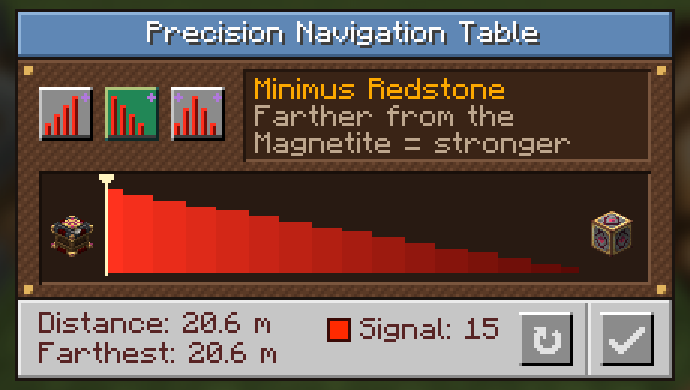
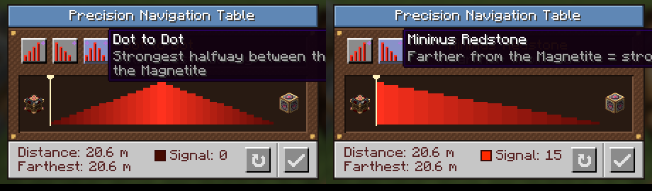

# 🧭 Mesa de Navegação de Precisão: como os modos funcionam

## Montando
1. Faça uma **Magnetita de Precisão** (Melhorador: Chip + Magnetita) e coloque onde quer a referência
   (sua base, um porto, uma pista de pouso...).
2. Clique nela com uma **bússola**: a bússola fica "presa" nela.
3. Faça uma **Mesa de Navegação de Precisão** (Melhorador: Chip + Mesa de Navegação) e coloque no seu veículo.
4. Coloque a bússola na mesa (clique direito, igual à mesa normal).
5. **Shift + clique direito com a mão vazia** → GUI → escolha o modo.
6. Puxe a redstone de qualquer lado da mesa (inclusive pelo bloco de baixo).

Sem bússola de precisão, a mesa se comporta **exatamente** como a Mesa de Navegação normal.



---

## A ideia da "distância máxima"

Pra existir um "meio do caminho", a mesa precisa de uma **régua**. A régua é:

> **a maior distância que a mesa já esteve da magnetita** (desde que a bússola foi colocada).

```
maxDistance = max(maxDistance, distânciaAtual)      // a cada tick, só cresce
ratio       = distânciaAtual / maxDistance          // 1 = no ponto mais longe, 0 = em cima da magnetita
```

Por que só cresce? Se a régua acompanhasse você o tempo todo, toda vez que você se afastasse ela aumentaria junto,
você estaria sempre "no ponto mais longe" e **nunca chegaria no meio**. Congelando o máximo, a viagem de volta
tem começo, meio e fim.

Exemplo: o dirigível saiu da base e foi até 300 m. Na volta:

| Distância atual | ratio | Somatic | Minimus | Ponto a Ponto | Ponto Senão Ponto |
|---|---|---|---|---|---|
| 300 m (ponto mais longe) | 1.00 | 0 | 15 | 0 | 15 |
| 225 m | 0.75 | 4 | 11 | 8 | 8 |
| **150 m (meio)** | 0.50 | 8 | 8 | **15** | **0** |
| 75 m | 0.25 | 11 | 4 | 8 | 8 |
| 0 m (na magnetita) | 0.00 | 15 | 0 | 0 | 15 |

Se ele passar de 300 m em algum momento, a régua passa a ser a nova distância.

**Quando a régua zera?**
- Ao tirar a bússola ou colocar uma presa em **outra** magnetita.
- No botão **↻ (Zerar distância máxima)** da GUI: a régua passa a ser a distância atual (útil pra "começar uma
  viagem nova" daqui).

---

## O formato de cada modo

Desenhando (eixo X = distância, da esquerda "mais longe" até a direita "magnetita"), igual ao gráfico da GUI:

```
Somatic             Minimus             Ponto a Ponto          Ponto Senão Ponto
15 |        ▁▃▅█    15 |█▅▃▁            15 |    ▅█▅         15 |█▅        ▅█
   |    ▁▃▅█████       |█████▅▃▁           |  ▃█████▃          |███▃    ▃███
 0 |▁▃▅█████████     0 |█████████▅▃▁     0 |▁█████████▁      0 |█████▁▁█████
   longe → magnetita   longe → magnetita   longe → magnetita   longe → magnetita
```



---

