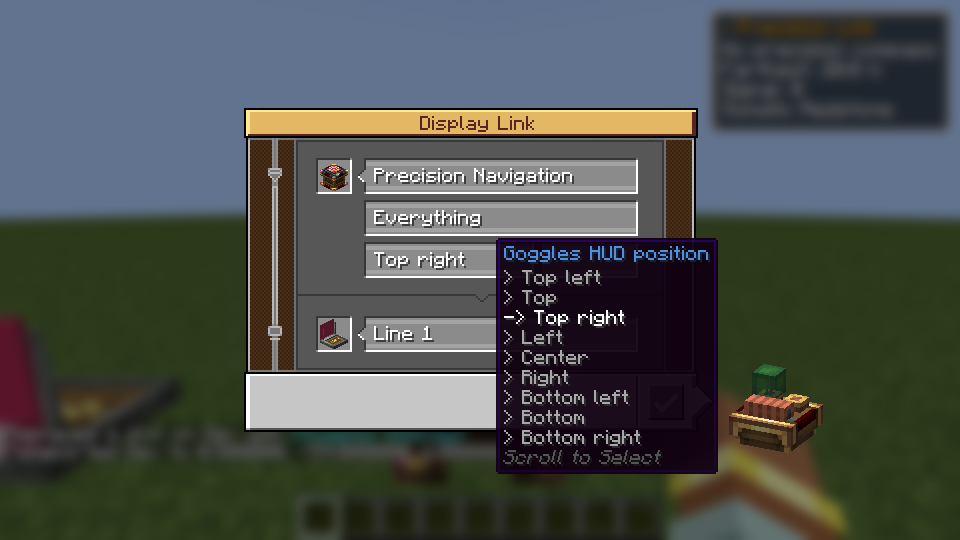
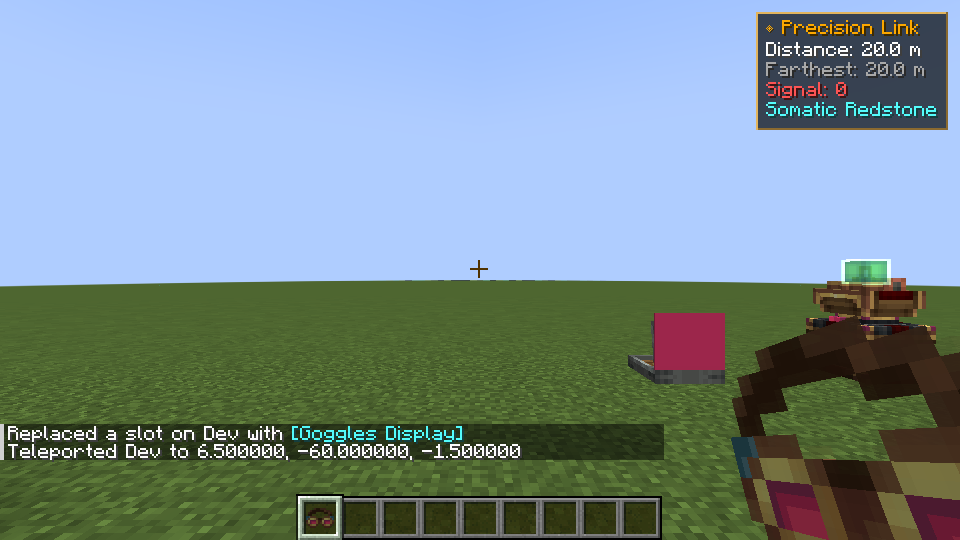
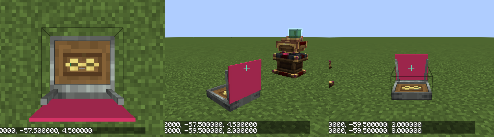

# 📡 Link de Precisão + Óculos com Display

O caminho da informação, da mesa até os seus olhos:

```
 [Mesa de Navegação de Precisão] ──(Transmissor de Exibição)──► [Link de Precisão] ──(sem fio)──► [Óculos com Display na cabeça]
        FONTE de dados                                  ALVO + transmissor              HUD na tela, a cada 2 ticks
```

## Fabricando (no Melhorador de Precisão)
| Núcleo | Resultado |
|---|---|
| Chip de Precisão + **Conexão de Redstone** | **Link de Precisão** |
| Chip de Precisão + **Óculos de Engenheiro** | **Óculos com Display** |

## Montando, passo a passo
1. Coloque o **Link de Precisão** no chão (animação `Spawn`, depois `Idle`).
2. Pegue um **Transmissor de Exibição** do Create, clique com ele no **Link de Precisão** (alvo) e coloque o Transmissor de Exibição
   **na Mesa de Navegação de Precisão** (fonte). É o jeito normal do Create.
3. Clique no Transmissor de Exibição pra abrir a tela dele. Escolha a fonte **"Navegação de Precisão"** e configure:
   - **Mostrar**: Distância / Distância + mais longe / Tudo / Barra da viagem
   - **Posição do HUD dos óculos**: 9 posições (cantos, bordas, centro)
   - **Tamanho do HUD**: Pequeno / Médio / Grande

   
4. Clique com o **Óculos com Display** no Link de Precisão: os óculos entram (animação `Idle2`).
5. Quando o Link estiver recebendo dados do Transmissor de Exibição, ele toca `Charge` e **pareia** os óculos.
   O tooltip deles passa a mostrar "Pareado com o Link de Precisão em X, Y, Z".
6. Clique com a **mão vazia** pra pegar os óculos de volta (animação `GIft`, depois `Idle`).
7. **Vista os óculos** (clique direito com eles na mão, ou coloque no slot de capacete). O HUD aparece.





## Detalhes
- Os Óculos com Display **também funcionam como Óculos de Engenheiro** (mostram rotação, stress etc. do Create).
- **Qualquer fonte** do Create pode mandar pro Link de Precisão (estoque, relógio, trens...): o HUD mostra o texto
  dela. Com a Mesa de Precisão, o HUD usa os números direto e fica bem suave.
- A Mesa de Precisão também funciona como fonte em placas, display boards, nixie tubes etc.
- Alcance: ilimitado, contanto que a área do Link de Precisão esteja carregada. Se não estiver, o HUD mostra
  "Sem sinal do Link de Precisão".

