
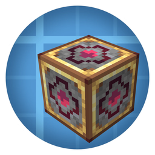

# Create: Don't Lose The Control

> Addon para **Create** e **Create: Aeronautics** — Minecraft **1.21.1** / **NeoForge**.
> Ideia e design: **mammut** · Código: feito com o Claude.
> 🇧🇷 **100% em português** (e Português de Portugal) · também em inglês.

Nunca mais perca o controle de onde está a sua base (ou o seu dirigível). Este mod adiciona uma pequena
linha de produção **de precisão**: você fabrica chips, monta uma máquina animada (o **Melhorador de Precisão**)
e com ela transforma blocos comuns em versões que **sabem a distância** até um ponto de referência.
Essa distância vira **sinal de redstone**, aparece **na bússola**, num **Transmissor de Exibição** do Create e até
num **HUD dentro dos óculos**.

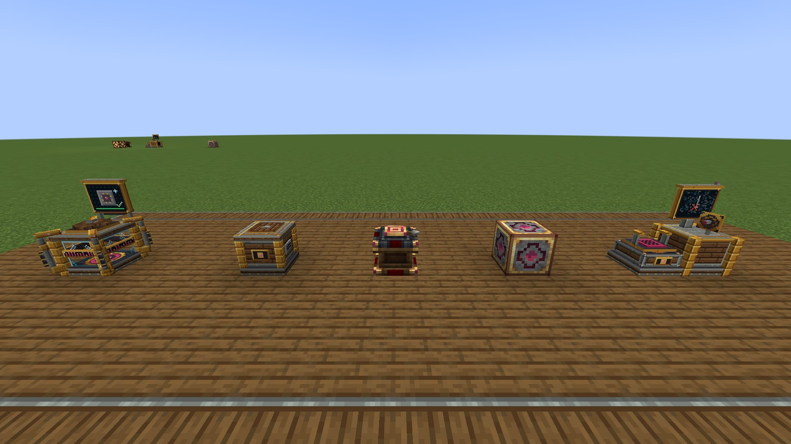

---

## 📦 O que tem no mod

| Bloco / item | Como consegue | Para que serve |
|---|---|---|
| **Manual de Precisão** | Bancada (sem forma): **Livro + Liga de Andesito** | Livro com **UI própria**: índice, receitas, imagens e passo a passo de tudo |
| **Chip de Precisão** | Bancada: Revestimento de Andesito em cima, Mecanismo de Precisão embaixo | Peça base de tudo |
| **Caixa de Precisão** | Bancada: Chip no meio + 4 Revestimentos de Andesito em cruz | O corpo do Melhorador |
| **Puxadores de Precisão** | **Montador Mecânico** do Create (grade 4×3): 4 botões / 4 eixos / 4 chips | Clique direito numa Caixa de Precisão → vira Melhorador |
| **Melhorador de Precisão** | Caixa + Puxadores | A máquina animada, com **monitor** e **HUD com o botão Melhorar** |
| **Magnetita de Precisão** | Melhorador: Chip + **Magnetita** | Bússola presa nela mostra direção **e distância** |
| **Mesa de Navegação de Precisão** | Melhorador: Chip + **Mesa de Navegação** | Solta **redstone pela distância** (4 modos, eixos, margem) e é **fonte do Transmissor de Exibição** |
| **Link de Precisão** | Melhorador: Chip + **Conexão de Redstone** | Recebe os dados do Transmissor e manda pros óculos (ocupa **2 blocos**, com monitor) |
| **Óculos com Display** | Melhorador: Chip + **Óculos de Engenheiro** | Óculos vestíveis com **HUD em tempo real** (e ainda funcionam como Óculos de Engenheiro) |

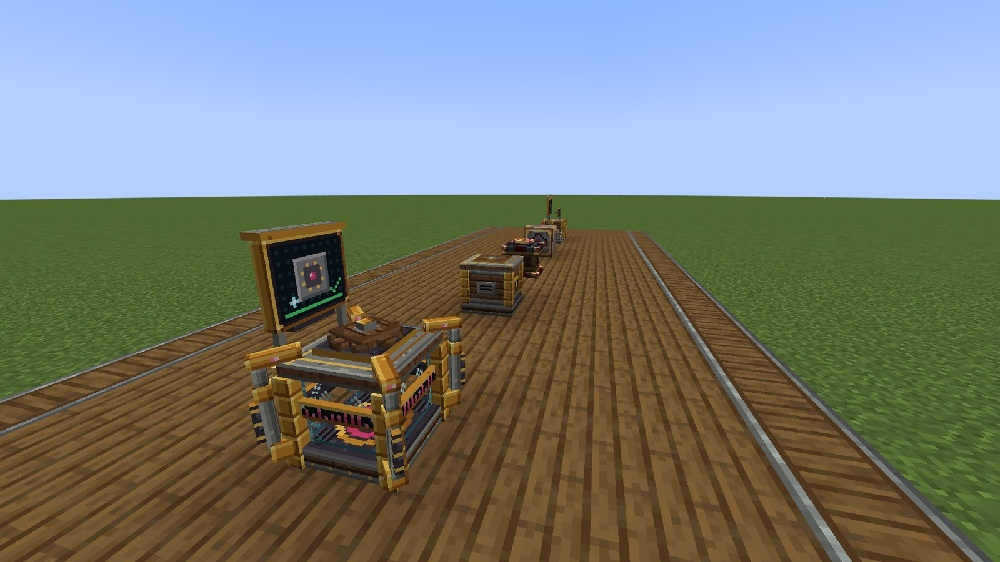

---

## 🛠️ Melhorador de Precisão

A máquina principal do mod. Câmara de vidro, **4 braços mecânicos**, engrenagem na tampa e um **monitor animado**
em cima, no estilo do Create (andesito, latão e madeira) com um toque tech (telas e luz magenta).

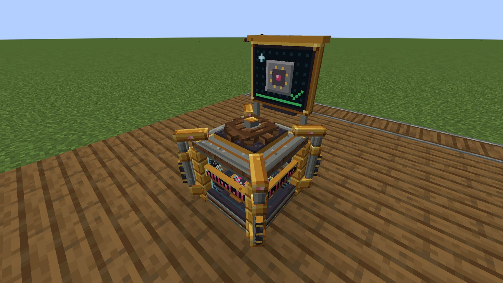

- **Clique direito** abre a **HUD**: slot do **Chip**, slot do **núcleo** (Magnetita, Mesa de Navegação, Conexão de
  Redstone ou Óculos de Engenheiro) e a **saída**, com a tela da máquina em tamanho grande.
- Aperte **Melhorar** (ou dê um **pulso de redstone**, pra automação). Passando o mouse no botão, ele diz o que falta.
- Cada receita tem a sua **animação de montagem** no monitor: radar na magnetita, mapa na mesa, torre de antena no
  link e lentes nos óculos. Os braços trabalham, saem faíscas e, no final, o resultado vai pra saída.
- **Funis, calhas, esteiras, hoppers** e qualquer mod com `IItemHandler` funcionam (entra pelos inputs, sai pela
  saída). Comparador lê o estado da máquina.

| HUD pronta pra melhorar | Resultado na saída |
|---|---|
| 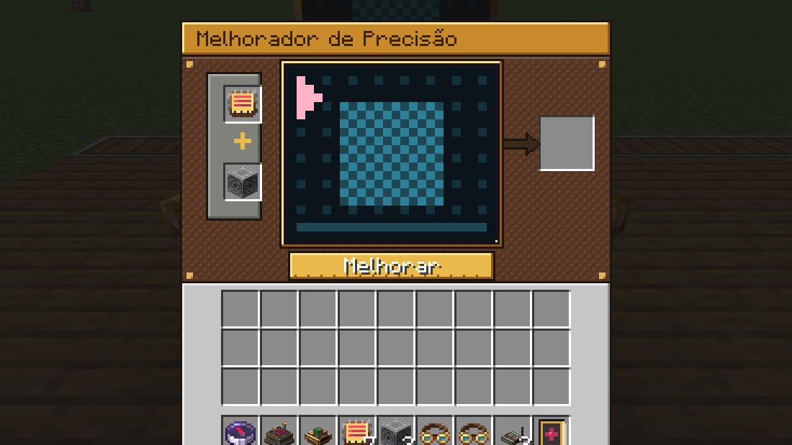 | 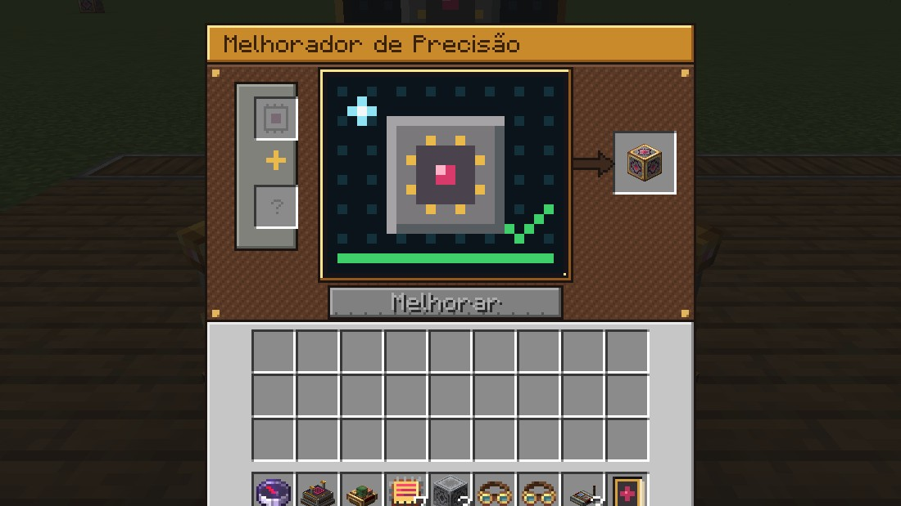 |

| Melhorando (faíscas e braços) | Receita dos óculos concluída |
|---|---|
| 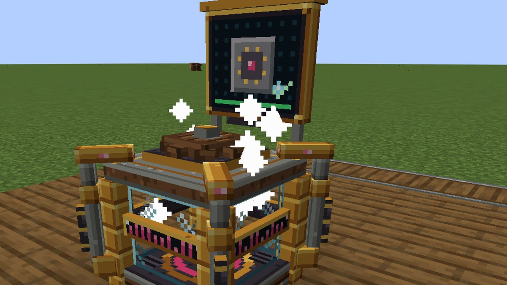 | 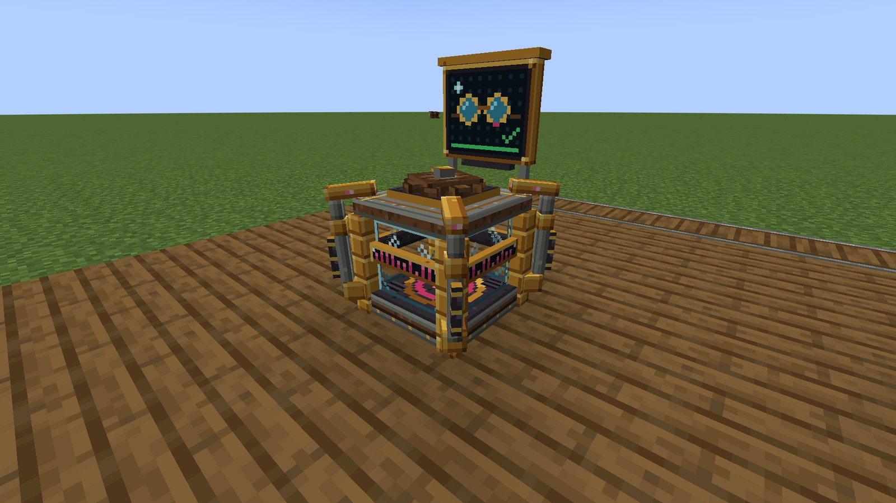 |

### Caixa e Puxadores
A **Caixa de Precisão** é a máquina "fechada"; os **Puxadores** são os 4 braços. Clique direito com os Puxadores
na Caixa e ela vira o Melhorador.

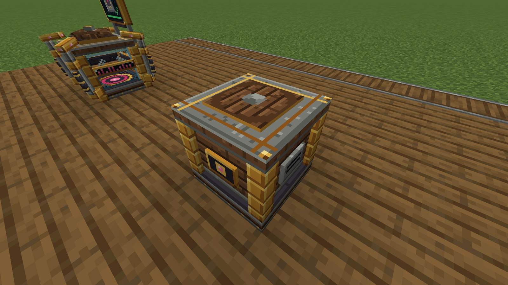

---

## 🧲 Magnetita de Precisão

Coloque onde quer a referência (sua base, um porto, uma pista de pouso...) e clique nela com uma **bússola**.
A bússola aponta pra ela, igual a uma Magnetita normal, e ainda mostra a **distância** acima da hotbar, com a cor
indo de verde (perto) para vermelho (longe).

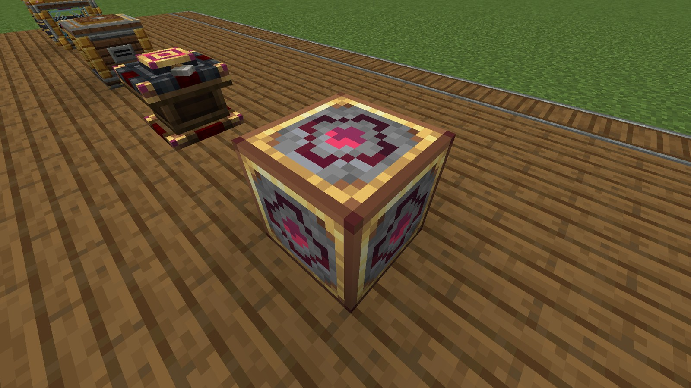

---

## 🧭 Mesa de Navegação de Precisão

Funciona **exatamente** como a Mesa de Navegação do Create Aeronautics (ponteiro, itens aceitos, sinais laterais),
e a Mesa normal também entende a bússola da Magnetita de Precisão. Mas coloque nela uma **bússola presa numa
Magnetita de Precisão** e ela vira um **sensor de distância**: solta redstone para os blocos em volta (inclusive
o de baixo).

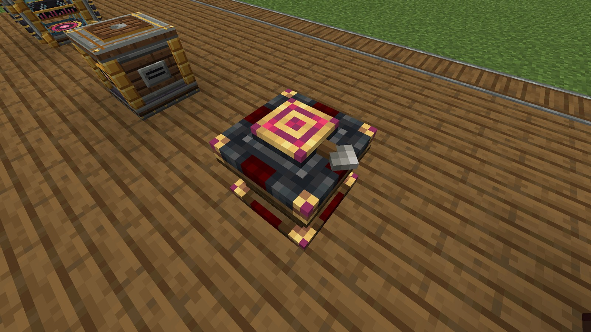

| Modo | Sinal |
|---|---|
| **Redstone Somático** | quanto mais **perto** da magnetita, mais forte |
| **Redstone Mínimo** | quanto mais **longe** da magnetita, mais forte |
| **Ponto a Ponto** | mais forte no **meio do caminho** |
| **Ponto Senão Ponto** | o contrário: mais **fraco** no meio do caminho, forte nas pontas |

- **Eixos**: mede a distância em **XYZ**, só no plano **XZ** (altura não conta), ou só em **X**, **Y** ou **Z**.
  Ex.: com XZ, ficar bem em cima da magnetita conta **0 m**, não importa a altura.
- **Margem de erro**: até N blocos do alvo já conta como **0 m** (chegou!). Shift no botão = ±10.
- O sinal vai de **1 a 15** enquanto a bússola estiver rastreando (nunca apaga só por estar longe).
- Funciona **em veículos** (Aeronautics/Sable): a distância e a setinha usam a posição real no mundo.
- A "régua" é a **maior distância que a mesa já esteve** da magnetita (dá pra zerar na GUI).
  Explicação completa: [MESA_DE_NAVEGACAO.md](MESA_DE_NAVEGACAO.md).

**Shift + clique direito com a mão vazia** abre a GUI, no estilo das telas do Create:

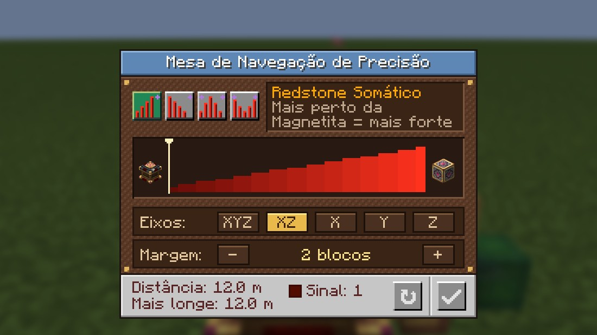

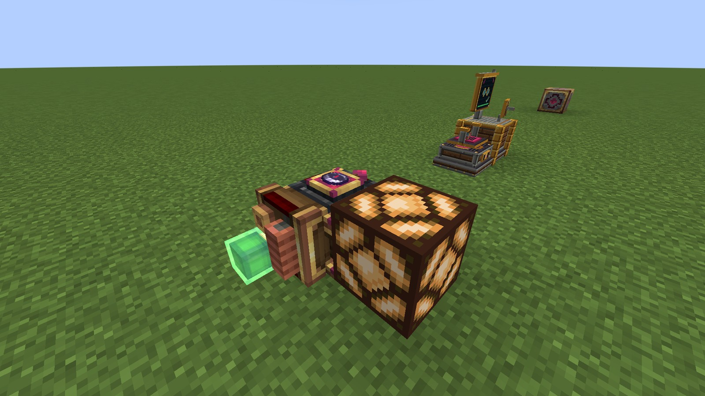

---

## 📡 Link de Precisão + Óculos com Display

O **Link de Precisão** ocupa **2 blocos**: a **doca** dos óculos e a **torre** com antena e monitor. Ao colocar, a
torre **sai de dentro da doca**. O monitor mostra o estado: sem sinal, dados chegando, pareando, pareado.

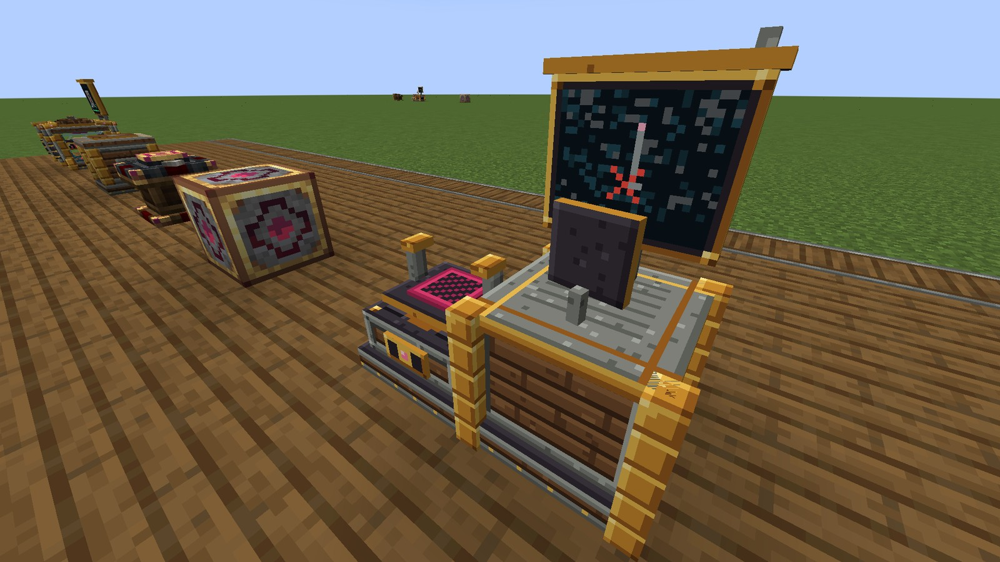

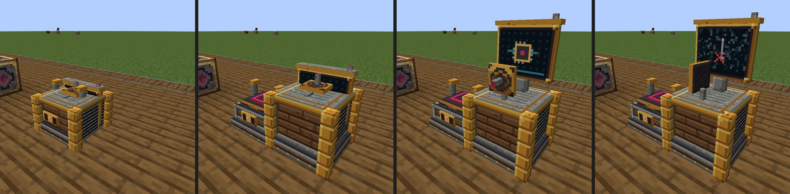

### Como montar o HUD
1. Clique com o **Transmissor de Exibição** na **doca** do Link de Precisão.
2. Coloque o Transmissor na **Mesa de Navegação de Precisão**.
3. Abra o Transmissor e escolha **Navegação de Precisão**: o que mostrar (distância, mais longe, sinal, modo,
   tudo...) e a **posição do HUD** (9 opções).
4. Coloque os **Óculos com Display** na doca: o Link faz a carga e os óculos ficam **pareados**.
5. Vista os óculos e pronto: o HUD aparece em tempo real, de qualquer lugar onde o Link esteja carregado.

| Tela do Transmissor | HUD nos óculos |
|---|---|
| 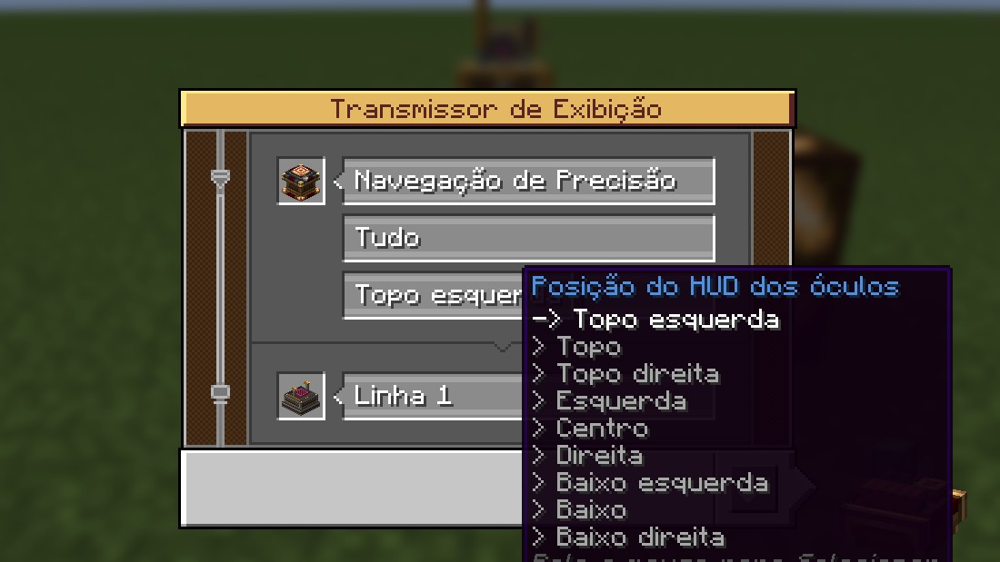 | 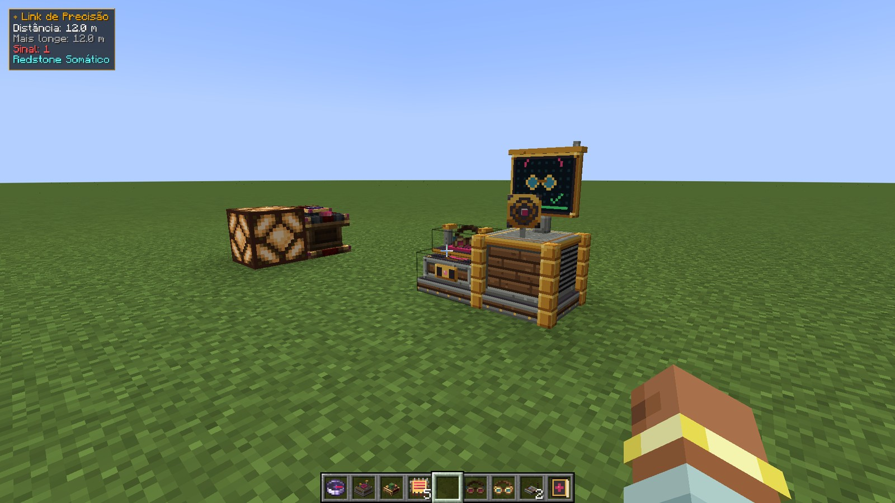 |

Mais detalhes: [PRECISION_LINK.md](PRECISION_LINK.md)

---

## 📖 Manual de Precisão

Clique direito com o **Manual de Precisão** e abre um livro com visual próprio:
- **Índice** clicável com todos os capítulos.
- **Receitas desenhadas** (bancada 3×3, Montador Mecânico 4×3 e as receitas do Melhorador).
- Passe o mouse num item pra ver o nome; **clique nele pra pular pro capítulo dele**.
- Virar página: setas, roda do mouse ou ←/→. Casinha (ou Backspace) volta pro índice. Ele lembra onde você parou.
- Segue o idioma do jogo (pt-BR, pt-PT ou inglês).

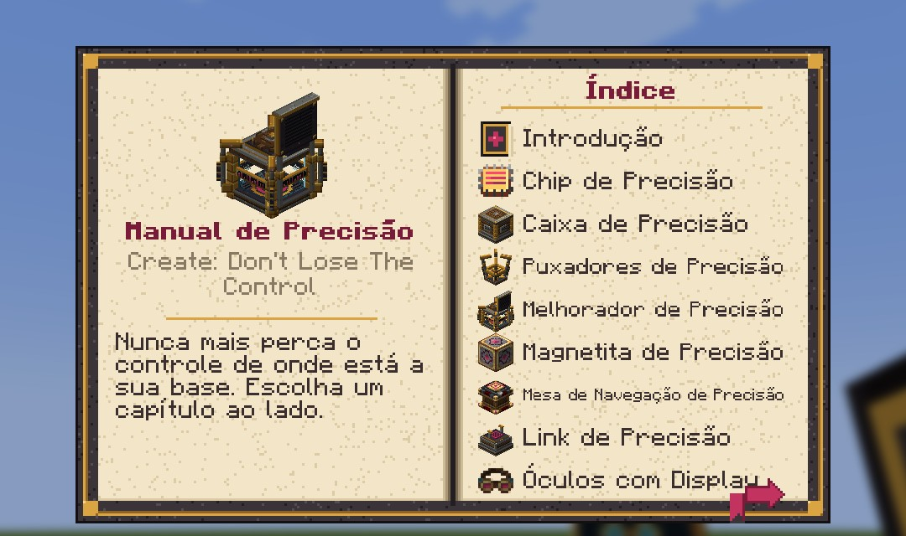

---

## ⬇️ Download e instalação

**[📥 Baixar a versão 1.5.2 (.jar)](https://github.com/jholmine50-dotcom/create-no-lose-the-control-releases/raw/main/downloads/create_dont_lose_the_control-1.21.1-1.5.2.jar)**
(ou pelo [CurseForge](https://www.curseforge.com/minecraft/mc-mods/create-dont-lose-the-control)).

1. NeoForge **21.1.247+** para Minecraft 1.21.1.
2. Na pasta `mods`: **Create 6.0.10+**, **Create: Aeronautics** (que já traz o *Create Simulated*), **Sable**
   e o `.jar` deste mod.

Novidades de cada versão: [CHANGELOG.md](CHANGELOG.md).

## 📄 Licença
Todos os direitos reservados ao autor (mammut). O código-fonte não é público.
Create, Create: Aeronautics/Simulated e Sable pertencem aos seus respectivos autores.
