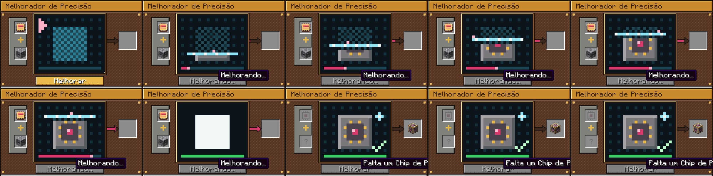
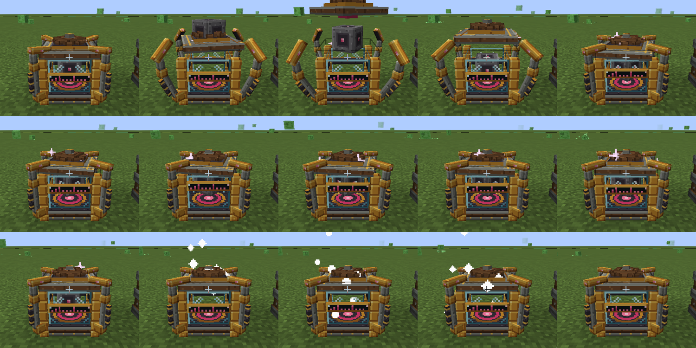
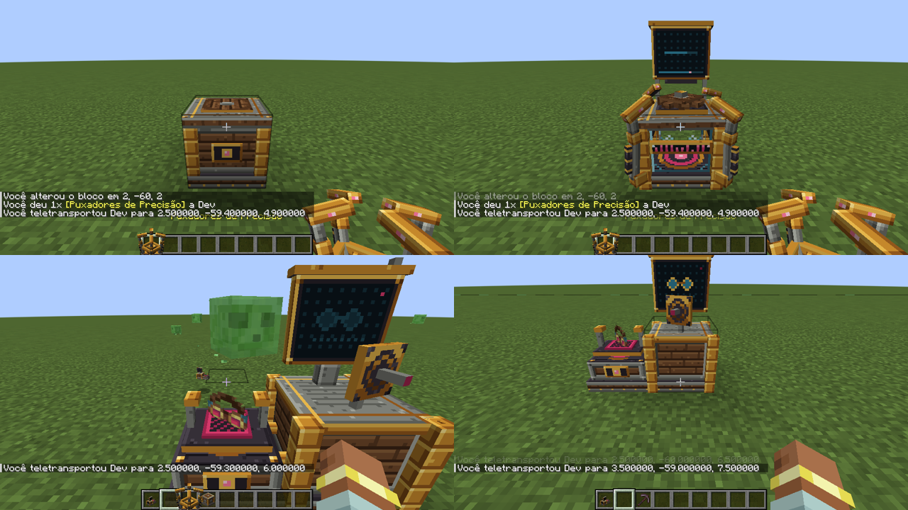
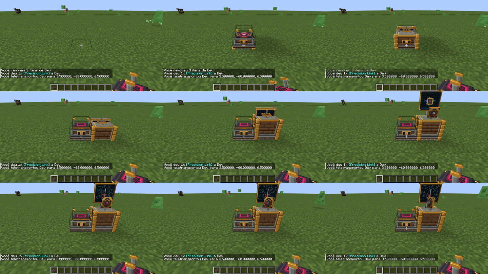
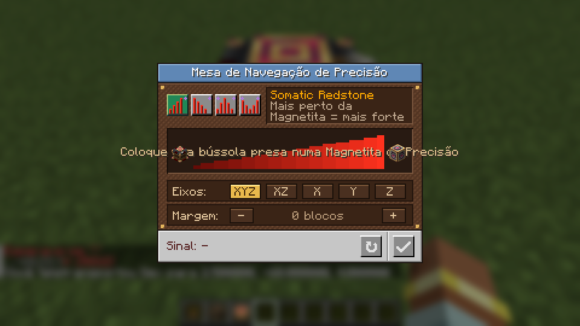
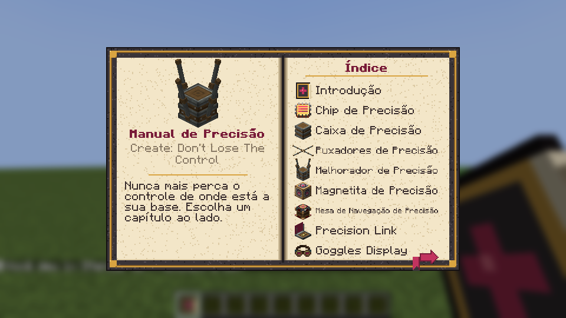
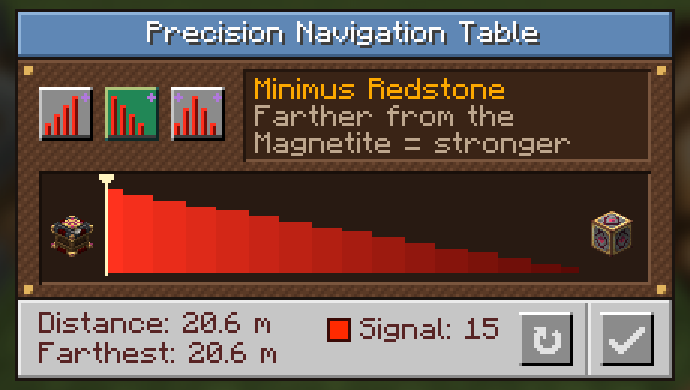

# Create: Don't Lose The Control

> Addon para **Create** e **Create: Aeronautics** — Minecraft **1.21.1** / **NeoForge**.
> Ideia e design: **mammut** · Código: feito com o Claude.

Nunca mais perca o controle de onde está a sua base (ou o seu dirigível). Este mod adiciona uma pequena
linha de produção "de precisão": você fabrica chips, monta uma máquina animada (o **Melhorador de Precisão**)
e com ela transforma blocos comuns em versões que **sabem a distância** até um ponto de referência.

---

## 📦 O que tem no mod

| Bloco / item | Como consegue | Para que serve |
|---|---|---|
| **Manual de Precisão** | Bancada (sem forma): **Livro + Liga de Andesito** | Livro no jogo com **UI própria**: índice, receitas, imagens e passo a passo de tudo |
| **Chip de Precisão** | Bancada: Revestimento de Andesito em cima, Mecanismo de Precisão embaixo | Peça base de tudo |
| **Caixa de Precisão** | Bancada: Chip no meio + 4 Revestimentos de Andesito em cruz | Vira o Melhorador |
| **Puxadores de Precisão** | **Montador Mecânico** do Create (grade 4×3): 4 botões / 4 eixos / 4 chips | Clique direito numa Caixa de Precisão → vira Melhorador |
| **Melhorador de Precisão** | Caixa + Puxadores | A máquina animada, com **monitor** e **HUD com o botão Melhorar** |
| **Magnetita de Precisão** | Melhorador: Chip + **Magnetita** (Lodestone) | Bússola presa nela mostra direção **e distância** |
| **Mesa de Navegação de Precisão** | Melhorador: Chip + **Navigation Table** | Mesa de navegação que solta **redstone pela distância** (4 modos + GUI) e é **fonte do Display Link** |
| **Precision Link** | Melhorador: Chip + **Redstone Link** | Alvo do Display Link que transmite os dados pros óculos (ocupa **2 blocos**, com monitor) |
| **Goggles Display** | Melhorador: Chip + **Óculos de Engenheiro** | Óculos vestíveis com **HUD em tempo real** (e ainda funcionam como Óculos de Engenheiro) |

### ✨ Novidades da 1.5.0: tudo Mk2
Todos os modelos foram refeitos no estilo do Create (revestimento de andesito, latão, madeira) com um toque tech
(vidro, telas, luz magenta), em **densidade 2×** (32 pixels por bloco, todos do mesmo tamanho).

- **Melhorador Mk2**: câmara de vidro, 4 braços mecânicos, engrenagem na tampa e um **monitor animado** em cima.
  Clique direito abre a **HUD**: coloque o Chip e o núcleo e aperte **Melhorar**. Cada receita tem a sua
  **animação de montagem** na tela (impressora, radar, torre de antena, lentes). Pulso de **redstone** também melhora.
- **Caixa e Puxadores Mk2**: a Caixa é a máquina fechada; os Puxadores são os 4 braços que se encaixam nela.
- **Precision Link Mk2**: ocupa **2 blocos** (doca dos óculos + torre com antena e monitor). Ao colocar, a torre
  **sai de dentro da doca**; o monitor mostra sem sinal, dados chegando, pareando, pareado...
- **Mesa de Navegação de Precisão**: escolha os **eixos** da distância (XYZ, XZ só horizontal, X, Y, Z), **margem de
  erro** (a até N blocos já conta 0 m) e o sinal agora vai de **1 a 15** (nunca apaga).
- A **Mesa de Navegação normal** agora entende a bússola da Magnetita de Precisão.

### 📖 O Manual de Precisão (novo na 1.4.0)
Clique direito com o **Manual de Precisão** e abre um livro com visual próprio (moldura dourada, cores da logo):
- **Índice** clicável com todos os capítulos (Chip, Caixa, Puxadores, Melhorador, Magnetita, Mesa, Link, Goggles).
- **Receitas desenhadas** (bancada 3×3, Montador Mecânico 4×3 e as receitas do Melhorador).
- Passe o mouse num item pra ver o nome; **clique nele pra pular pro capítulo dele**.
- Virar página: setas, roda do mouse ou ←/→. Casinha (ou Backspace) volta pro índice. Ele lembra onde você parou.
- Em **português e inglês** (segue o idioma do jogo).

### O Melhorador de Precisão
- Clique direito abre a **HUD**: slot do **Chip**, do **núcleo** (Magnetita, Navigation Table, Redstone Link ou
  Óculos de Engenheiro) e a **saída**, com a tela da máquina em tamanho grande.
- Aperte **Melhorar** (ou dê um **pulso de redstone**): ele toca a animação `charge`, a tela mostra a montagem da
  receita e, no final, o resultado vai pra saída. Passando o mouse no botão, ele diz o que falta.
- Durante o `charge`, o cubo que aparece dentro da caixa é o núcleo: a magnetita do modelo **ou o modelo real
  da Navigation Table**, nas mesmas posições, rotações e escala da animação.
- **Funis, calhas, esteiras do Create, hoppers** e qualquer mod que use `IItemHandler` funcionam
  (entra só pelos inputs, sai só pela saída). Comparador lê o estado da máquina.

### A Magnetita de Precisão
Clique direito com uma **bússola** nela. A bússola aponta para ela (igual a uma Magnetita normal) e ainda mostra
a distância acima da hotbar, com a cor indo de verde (perto) para vermelho (longe).

### A Mesa de Navegação de Precisão
Funciona **exatamente** como a Navigation Table do Create Aeronautics (ponteiro, itens aceitos, sinais laterais).
Mas se você colocar nela uma **bússola presa numa Magnetita de Precisão**, ela vira um sensor de distância e
manda redstone para os blocos em volta (inclusive o de baixo) conforme o **modo** (são 4):

| Modo | Sinal |
|---|---|
| **Somatic Redstone** | quanto mais **perto** da magnetita, mais forte |
| **Minimus Redstone** | quanto mais **longe** da magnetita, mais forte |
| **Dot to Dot** | mais forte no **meio do caminho** |
| **Dot else Dot** | o contrário: mais **fraco** no meio do caminho, forte nas pontas |

A "régua" usada é a **maior distância que a mesa já esteve** da magnetita, e ela só cresce. Assim o "meio do
caminho" existe de verdade. Explicação completa: [MESA_DE_NAVEGACAO.md](MESA_DE_NAVEGACAO.md).

**Shift + clique direito com a mão vazia** abre a GUI, no estilo das telas do Create:

---

## ⬇️ Instalação (para jogar)
1. NeoForge **21.1.247+** para Minecraft 1.21.1.
2. Na pasta `mods`: **Create 6.0.10+**, **Create: Aeronautics** (que já traz o *Create Simulated*), **Sable**
   e o `.jar` deste mod.

## 📡 Precision Link + Goggles Display
Como montar o HUD dos óculos: [PRECISION_LINK.md](PRECISION_LINK.md)

## ⬇️ Download
**[📥 Baixar a versão 1.5.0 (.jar)](https://github.com/jholmine50-dotcom/create-no-lose-the-control-releases/raw/main/downloads/create_dont_lose_the_control-1.21.1-1.5.0.jar)** e coloque na pasta `mods`.

Requisitos: NeoForge 21.1.247+, Create 6.0.10+, Create: Aeronautics e Sable. Novidades de cada versão: [CHANGELOG.md](CHANGELOG.md).

## 📄 Licença
Todos os direitos reservados ao autor (mammut). O código-fonte não é público.
Create, Create: Aeronautics/Simulated e Sable pertencem aos seus respectivos autores.
